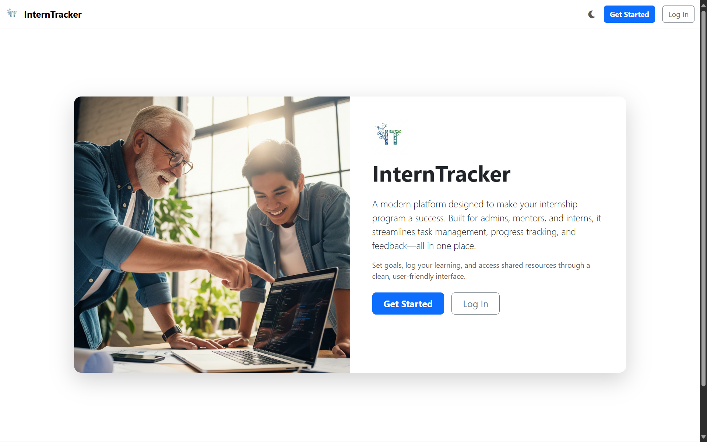

# InternTracker

Manage intern tasks, journals, goals, reports, and learning resources through a role-based ASP.NET Core MVC application.

InternTracker is an individual learning and demonstration project with Admin, Mentor, and Intern workflows. It uses server-rendered Razor views and SQL Server persistence. Additional authorization, upload-hardening, and operational work is required before a production deployment.

## Key Features

- Cookie authentication with BCrypt password hashing and session-backed user context.
- Intern tasks, work sessions, journals, goals, report uploads, and notifications.
- Mentor task assignment, progress dashboards, and report feedback.
- Administrator user/role management, resources, and system reports.
- Profile email/password changes and profile pictures.
- Demo administrator registration gated by Development mode and explicit configuration.

## Tech Stack

| Layer | Technology |
|---|---|
| Application | C#, ASP.NET Core MVC 9, Razor |
| Persistence | Entity Framework Core 9, SQL Server |
| Authentication | ASP.NET Core cookie authentication, BCrypt.Net-Next |
| Interface | HTML, CSS, JavaScript, Chart.js |
| Regression tests | xUnit, ASP.NET Core test host |

Authentication is custom cookie-based application code; it does not use the ASP.NET Core Identity account-management framework.

## Architecture & Project Structure

```text
.
├── InternTracker.sln
├── InternTracker/
│   ├── Controllers/       # Role workflows and account/profile actions
│   ├── Models/            # Entities and view models
│   ├── Data/              # EF Core database context
│   ├── Migrations/        # SQL Server schema migrations
│   ├── Views/             # Server-rendered Razor UI
│   ├── wwwroot/           # Static assets and local uploaded files
│   └── Program.cs         # Authentication, session, MVC, persistence setup
├── InternTracker.Tests/   # Security regression tests
├── .config/               # Repository-local EF CLI tool manifest
└── .github/workflows/     # Build and regression checks
```

Controllers use EF Core directly. Admin and Mentor controllers have role requirements; profile actions require authentication. The current mentor workflow lists all interns rather than maintaining a separate mentor-to-intern assignment model.

## Getting Started

Install the .NET 9 SDK and a reachable SQL Server instance. Windows LocalDB is suitable for a local demo. The repository includes the client assets used by Razor views; npm is not required for the server build.

```bash
git clone https://github.com/MustafArikan/InternTracker.git
cd InternTracker
dotnet restore InternTracker.sln
dotnet tool restore
```

Set the database connection before applying migrations. For a PowerShell LocalDB example:

```powershell
$env:ConnectionStrings__InternTrackerContext = 'Server=(localdb)\MSSQLLocalDB;Database=InternTrackerDemo;Trusted_Connection=True;MultipleActiveResultSets=true'
dotnet ef database update --project InternTracker
dotnet run --project InternTracker --launch-profile https
```

The configured HTTPS launch profile uses `https://localhost:7289`; its HTTP endpoint is `http://localhost:5095`. Trust your local development certificate if your browser requires it.

## Configuration

| Key | Purpose |
|---|---|
| `ConnectionStrings__InternTrackerContext` | SQL Server connection; environment value overrides tracked defaults |
| `ASPNETCORE_ENVIRONMENT` | Runtime environment; the launch profiles select `Development` |
| `Demo__EnableAdminRegistration` | Defaults to false; permits demo admin registration only in Development |

To bootstrap a local demonstration administrator, start the app from a PowerShell session with:

```powershell
$env:Demo__EnableAdminRegistration = 'true'
dotnet run --project InternTracker --launch-profile https
```

Open `/Account/RegisterAdmin`, create the demo administrator, then remove the variable and restart. Both GET and POST actions return 404 when the gate is closed. Production mode keeps the route closed even when the flag is set. The flag enables registration for anyone who can reach that Development instance; use it only on your own local machine.

Never place real database credentials in tracked settings files.

## Usage

1. Register through **Get Started** to create an Intern account.
2. Sign in to reach the dashboard associated with your role.
3. Use the Admin area to manage users and roles and the Mentor area to assign tasks and review reports.
4. Use the Intern area to record work, maintain journals/goals, and submit reports.



Existing role screenshots are available in [wwwroot/Git_Images](InternTracker/wwwroot/Git_Images).

## Testing

```bash
dotnet test InternTracker.Tests/InternTracker.Tests.csproj --configuration Release
```

The test host exercises both administrator-registration actions across environment/flag combinations and verifies anonymous profile requests are challenged. It does not require SQL Server because these cases stop before database writes. Full task/report workflows and database migrations still need integration testing with SQL Server.

## Development & Quality

```bash
dotnet build InternTracker.sln --configuration Release
dotnet list InternTracker/InternTracker.csproj package --vulnerable --include-transitive
```

GitHub Actions builds the app and runs the regression suite on pull requests and pushes to `master`. Nullable-analysis warnings remain in the existing application; a successful build does not mean they have been resolved. The npm manifest's placeholder `test` command is not the .NET test suite.

## Deployment

No production deployment is configured. Before exposing an instance, review per-record authorization, upload validation and private file delivery, persistence/backup of uploads and database, authentication/session behavior, secure transport, dependency updates, and error handling. The demo admin gate addresses one entry point and is not a complete production-security review.

## Roadmap

- Add SQL Server integration tests for role and record-ownership boundaries.
- Replace public static upload storage with authorized file delivery and validated file types/sizes.
- Remove nullability warnings and align session lifetime with authentication.
- Plan a supported framework upgrade and documented production bootstrap process.

## Contributing

Use focused pull requests with a reproduction and regression test for behavior changes. Preserve the existing role workflows, never include local database credentials or uploaded personal files, and report build/test results.

## License

Distributed under the [MIT License](LICENSE).

## Author

[Mustafa Arıkan](https://github.com/MustafArikan)
